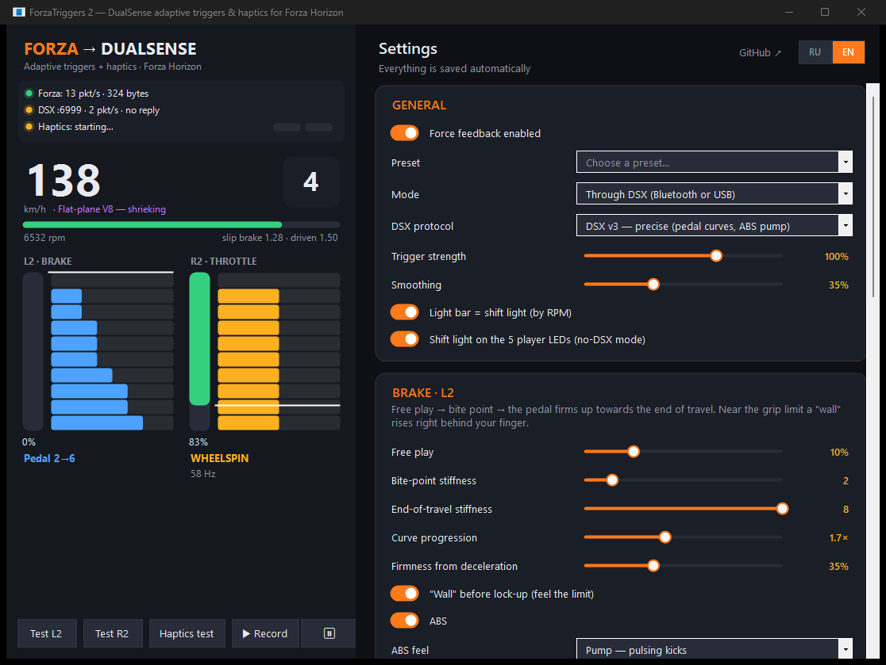
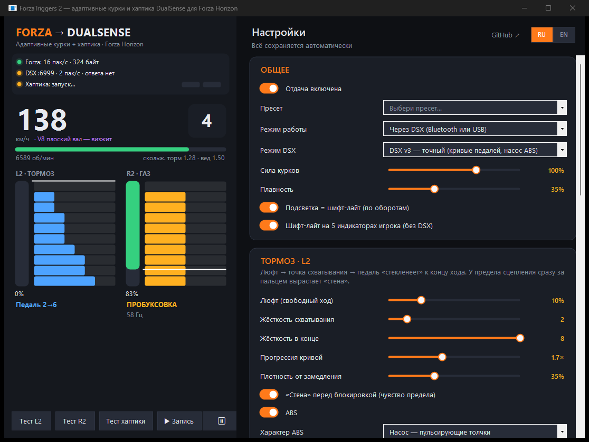

<div align="center">

# ForzaTriggers — DualSense adaptive triggers & haptics for Forza Horizon 6 / 5 on PC

**Feel the brake pedal, ABS, wheelspin, the rev limiter, gear shifts, kerbs, jumps and crashes on your PS5 DualSense controller in Forza Horizon — on PC.**

[](https://github.com/GefryV3/ForzaTriggers-DualSense-Forza-Horizon/releases/latest)
[](https://github.com/GefryV3/ForzaTriggers-DualSense-Forza-Horizon/releases)
[](LICENSE)


[English](#english) · [Русский](#русский)



</div>

---

<a name="english"></a>

## What is it?

Forza Horizon on PC does **not** support the DualSense adaptive triggers or the real (voice-coil) haptics — you only get plain rumble.
**ForzaTriggers** fixes that. It reads Forza's built-in telemetry (*Data Out*), simulates what a real car's pedals feel like and drives:

- 🎮 **both adaptive triggers** (L2 brake, R2 throttle) with a physically based pedal model;
- 📳 **the HD haptic motors** — left and right side independently, 48 kHz audio-rate signal, not cheap rumble;
- 💡 **the light bar and player LEDs** as a shift light.

It is a single small `.exe` (~100 KB), free and open source, no installer, no telemetry of its own, no ads.

### Features

**L2 – brake**
- 10-zone pedal curve like a real brake: free play → bite point → the pedal firms up towards the end of travel (adjustable progression);
- the whole pedal gets firmer when the car is *actually* decelerating hard;
- **"wall" at the grip limit** — when the wheels are about to lock, a stop rises right behind your finger, so you can trail-brake at the threshold by feel;
- **ABS** you can feel: *Pump* (pulsing kicks), *Pulse* or *Knock*, adjustable threshold, strength and frequency;
- wheel **lock-up** shudder when in-game ABS is off.

**R2 – throttle**
- light spring that gets heavier under acceleration; optional **kickdown** detent near the floor;
- **wheelspin** vibration whose frequency rises with slip and speed;
- **rev limiter** bounce, **gear-shift kick** (single hard hit on upshift, double on downshift), launch jolt.

**Haptics (voice-coil motors)**
- **engine** pulse that follows RPM, with a character per engine type: cross-plane V8 burble, flat-plane V8 shriek, V10, V12, rotary, inline-4, five, six, electric…
- **weight transfer** — in corners the engine feel shifts to the outer side of the controller;
- **impacts** from the side they come from, suspension hits, potholes, **landings** (the longer the jump, the harder the hit);
- tyre slip grain, wheelspin, ABS clicks, gear-shift clunk with torque cut, brake **dive** and **launch**.

**App**
- live view of pedal input, trigger curve, speed, gear, RPM, slip and haptic levels;
- presets (*Realistic / Soft / Hardcore / Drift*), every effect adjustable, auto-saved;
- **English and Russian UI** (follows Windows, switch any time);
- built-in tests for L2, R2 and haptics — check everything without starting the game;
- telemetry recorder for tuning and bug reports.

### Two ways to run

| | **A. Direct USB (no DSX)** — best | **B. Through DSX** |
|---|---|---|
| Connection | USB cable | Bluetooth or USB |
| Triggers | ✅ written straight to the controller | ✅ via DSX |
| Haptics | ✅ 16-bit, ~10 ms latency | ✅ 8-bit via DSX (Bluetooth needs DSX+) |
| Extra software | [ViGEmBus](https://github.com/nefarius/ViGEmBus/releases) + [HidHide](https://github.com/nefarius/HidHide/releases) (free) | [DSX](https://store.steampowered.com/app/1812620/DSX/) (paid, Steam) |
| Game sees | a virtual Xbox 360 controller created by the app | DSX's virtual controller |

## Quick start

1. **Download** `ForzaTriggers.zip` from [Releases](https://github.com/GefryV3/ForzaTriggers-DualSense-Forza-Horizon/releases/latest) and unzip it anywhere.
2. **Enable telemetry in Forza Horizon:** *Settings → HUD and Gameplay → Data Out = On, Data Out IP Address = `127.0.0.1`, Data Out IP Port = `5300`.*
3. Choose a mode in *Settings → General → Mode*:

**A. Direct USB (recommended)**
1. Install [ViGEmBus](https://github.com/nefarius/ViGEmBus/releases) and [HidHide](https://github.com/nefarius/HidHide/releases), reboot.
2. In *HidHide Configuration Client*: hide the DualSense from games and add `ForzaTriggers.exe` (and `ForzaTriggers.Diag.exe`) to the allowed applications.
3. Connect the DualSense **with a USB cable** and turn Bluetooth off (if the pad is paired over both, Windows won't enable the USB haptics channel — the app will warn you).
4. Close DSX, start `ForzaTriggers.exe`, pick *No DSX — direct USB*.

**B. Through DSX**
1. DSX: *Settings → Controller → Networking* → enable UDP, port `6969`.
2. DSX haptics: *Haptics → Audio → source System Audio* and pick the output device the app should write to; turn **game Rumble off** (it overrides haptics) and set the speaker volume for haptics to 0. The app checks your DSX profile and tells you if something is off.
3. Start `ForzaTriggers.exe`, pick *Through DSX*.

Then press **Test L2**, **Test R2** and **Haptics test** — you should feel all of it before you even start the game.

> **Microsoft Store / Game Pass version only:** UWP apps can't send UDP to localhost by default. Run once in an admin PowerShell:
> ```powershell
> Get-AppxPackage *Forza* | Select Name, PackageFamilyName
> CheckNetIsolation LoopbackExempt -a -n=<PackageFamilyName from above>
> ```
> The Steam version doesn't need this.

## Tuning tips

- The left panel shows live **brake slip / driven slip**. If ABS kicks in too early or too late, set *ABS threshold* slightly above/below the number you see when braking hard.
- For drifting, use the *Drift* preset or raise *Wheelspin threshold*.
- If haptics says *"set to stereo"*: *Sound settings → DualSense → Properties → Configure → Quadraphonic.*
- Settings are stored in `ForzaTriggers.ini` next to the exe.
- On exit the triggers and light bar are returned to normal.

## Troubleshooting

| Symptom | Fix |
|---|---|
| *Forza: no data* | Data Out is off, wrong IP/port, or (Store version) the loopback exemption is missing. |
| *Port 5300 is busy* | Another telemetry tool (SimHub, ForzaDSX…) or a second copy is using it. Close it or change the port in both places. |
| *No USB DualSense found* | Use a cable; in HidHide allow `ForzaTriggers.exe`. |
| *DSX is running* in direct mode | Close DSX completely (tray icon). |
| Triggers work, no haptics in DSX mode | Turn DSX game *Rumble* off, set *Haptics → Audio → System Audio*. |
| Haptics silent over Bluetooth in DSX mode | Bluetooth haptics in DSX requires DSX+. |

## Build from source

No Visual Studio needed — Windows already ships the C# compiler:

```bat
build.cmd
```

The binaries land in `dist\`. The code is plain C# 5 / .NET Framework 4 + WinForms, no dependencies:

| File | What |
|---|---|
| `src/ForzaTriggers.cs` | telemetry parser, trigger physics, settings, DSX protocol |
| `src/Synth.cs` | tactile synthesizer (20–180 Hz band, impacts, engine patterns, limiter) |
| `src/Haptics.cs` | WASAPI output to the controller's motor channels, DSX profile check |
| `src/Direct.cs` | direct USB mode: HID, raw trigger effects, ViGEmBus virtual Xbox 360 pad |
| `src/EngineCharacters.cs` | engine "personalities" by cylinder count and redline |
| `src/Ui.cs` | the dark UI (custom-drawn controls) |
| `src/Loc.cs` | RU / EN strings |
| `src/SelfTest.cs` | `ForzaTriggers.Diag.exe`: scenario tests, WAV render, telemetry analysis |

`ForzaTriggers.Diag.exe` runs the trigger scenarios without a game (`Diag.exe`), renders the haptic signal to WAV (`Diag.exe wav out.wav`) and analyses a recording (`Diag.exe analyze telemetry-*.bin`).

## Compatibility

- Built and tuned on **Forza Horizon 6**. The Data Out format is shared with **Forza Horizon 5 / 4** and **Forza Motorsport (2023) / 7**, which the parser also supports — reports welcome!
- **DualSense** and **DualSense Edge**.
- Windows 10 / 11, x64.

## Contributing

Issues and pull requests are welcome: bug reports (attach a `telemetry-*.bin` recording made with the ▶ Record button), effect ideas, translations, testing on other Forza titles.
If the app made your Forza sessions better, **please ⭐ star the repo** — it helps other DualSense owners find it.

---

<a name="русский"></a>

## Русский

**ForzaTriggers** — адаптивные курки и настоящая хаптика DualSense (геймпад PS5) в **Forza Horizon 6 / 5 на ПК**. Сама игра на ПК курки и вибромоторы DualSense не поддерживает — только обычную вибрацию. Приложение читает встроенную телеметрию Forza (*Data Out*), моделирует педали настоящей машины и управляет курками, вибромоторами (левый и правый борт отдельно) и подсветкой.



### Что умеет

- **L2 (тормоз):** кривая настоящей педали по 10 зонам — люфт → точка схватывания → педаль «стекленеет»; педаль плотнее при реальном сильном замедлении; **«стена» у предела сцепления** — порог торможения держится на ощупь; **ABS** на выбор (насос / пульс / стук); тряска при блокировке колёс.
- **R2 (газ):** лёгкая пружина, тяжелеет при разгоне; кикдаун; **пробуксовка**, **отсечка**, **толчок переключения**, рывок на старте.
- **Хаптика:** «пульс» мотора по оборотам с характером по типу (американский V8 бурчит, V8 с плоским валом визжит, V10, V12, роторный, «четвёрка», электро…); **перенос веса** в поворотах; удары с той стороны, откуда прилетело; ямы, кочки, **приземления**; скольжение шин, щелчки ABS, «клац» коробки, нырок при торможении.
- Живая панель: педали, кривые курков, скорость, передача, обороты, скольжение, уровни моторов.
- Пресеты (*Реализм / Мягкий / Хардкор / Дрифт*), все эффекты настраиваются, сохраняются автоматически.
- **Русский и английский интерфейс** (по языку Windows, переключается кнопками RU/EN).
- Тесты L2 / R2 / хаптики без игры, запись телеметрии.

### Быстрый старт

1. Скачай `ForzaTriggers.zip` из [Releases](https://github.com/GefryV3/ForzaTriggers-DualSense-Forza-Horizon/releases/latest) и распакуй куда угодно.
2. В Forza Horizon: *Настройки → HUD и геймплей → Data Out = Вкл, IP = `127.0.0.1`, порт = `5300`.*
3. Выбери режим (*Настройки → Общее → Режим работы*):
   - **Без DSX — USB напрямую (лучший):** поставь [ViGEmBus](https://github.com/nefarius/ViGEmBus/releases) и [HidHide](https://github.com/nefarius/HidHide/releases); в HidHide спрячь DualSense от игр и разреши `ForzaTriggers.exe`; геймпад — **только по кабелю**, Bluetooth выключи; DSX закрой.
   - **Через DSX:** в DSX включи UDP (порт `6969`); *Haptics → Audio → System Audio*; вибрацию игры (*Rumble*) **выключи** — она глушит хаптику. По Bluetooth хаптику в DSX передаёт только DSX+.
4. Нажми «Тест L2», «Тест R2», «Тест хаптики» — всё должно ощущаться ещё до запуска игры.

**Только для Microsoft Store / Game Pass** (Steam не нужно) — один раз в PowerShell от администратора:
```powershell
Get-AppxPackage *Forza* | Select Name, PackageFamilyName
CheckNetIsolation LoopbackExempt -a -n=<PackageFamilyName из списка выше>
```

### Подстройка и проблемы

- Слева видно текущее **скольжение (торм / вед)**. ABS срабатывает слишком рано или поздно — ставь «Порог ABS» чуть выше или ниже этого числа.
- Для дрифта — пресет «Дрифт» или выше «Порог пробуксовки».
- «Настроен как стерео» → *Параметры звука → DualSense → Свойства → Настроить → Квадрофония*.
- «Порт 5300 занят» — закрой SimHub / ForzaDSX / второй экземпляр.
- Настройки — в `ForzaTriggers.ini` рядом с exe. При выходе курки и подсветка возвращаются в обычный режим.

### Сборка

`build.cmd` — компилятор C# уже есть в Windows (.NET Framework 4), Visual Studio не нужна. Готовые файлы — в `dist\`.

Нашёл баг или есть идея — открывай issue (приложи запись `telemetry-*.bin`, кнопка «▶ Запись»). Понравилось — **поставь ⭐**, так проект найдут другие владельцы DualSense.

---

<sub>Keywords: DualSense PC Forza Horizon 6, PS5 controller adaptive triggers Forza, DualSense haptic feedback Forza Horizon 5 PC, Forza Horizon DualSense support, DSX Forza, DualSenseX Forza adaptive triggers, Forza telemetry Data Out, DualSense Edge, ViGEmBus, HidHide.</sub>

<sub>ForzaTriggers is an independent fan project. It is not affiliated with or endorsed by Microsoft, Xbox Game Studios, Playground Games, Turn 10 or Sony Interactive Entertainment. "Forza", "Forza Horizon", "DualSense" and "PlayStation" are trademarks of their respective owners.</sub>
